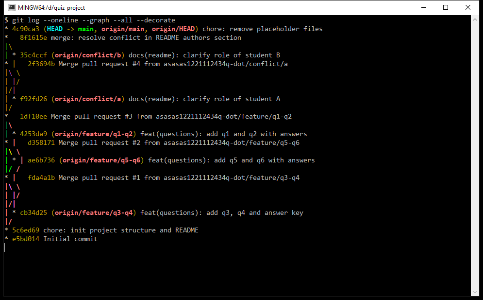
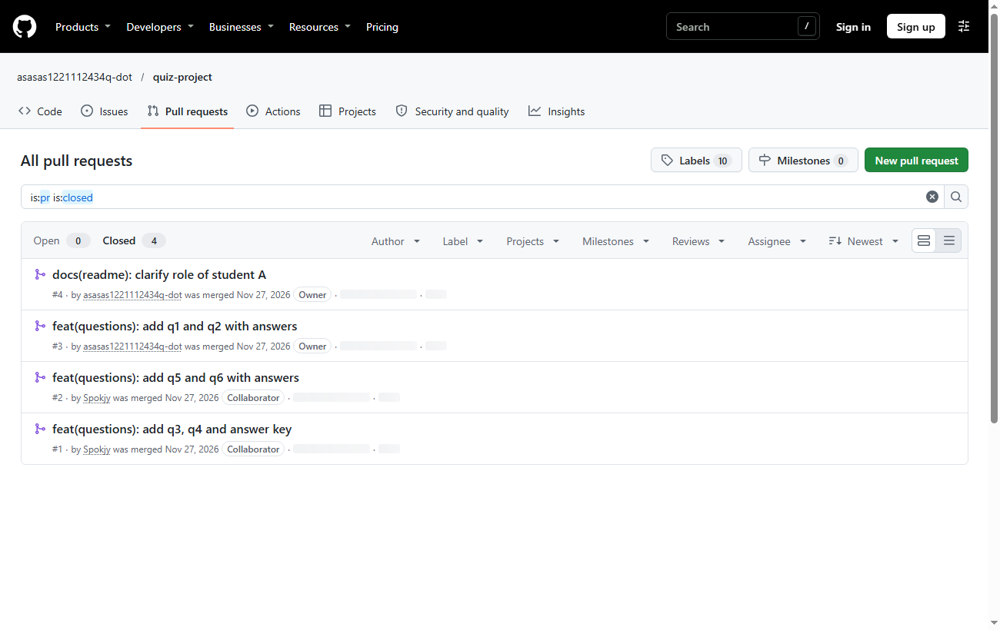
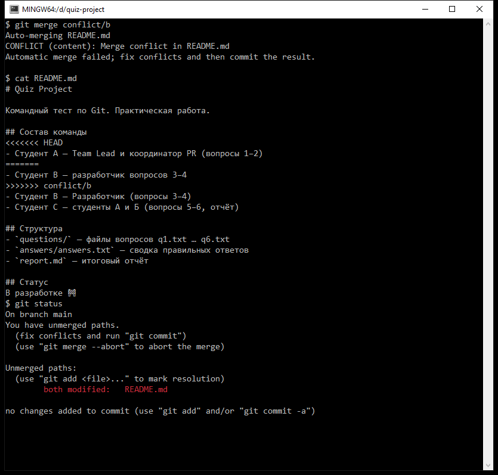
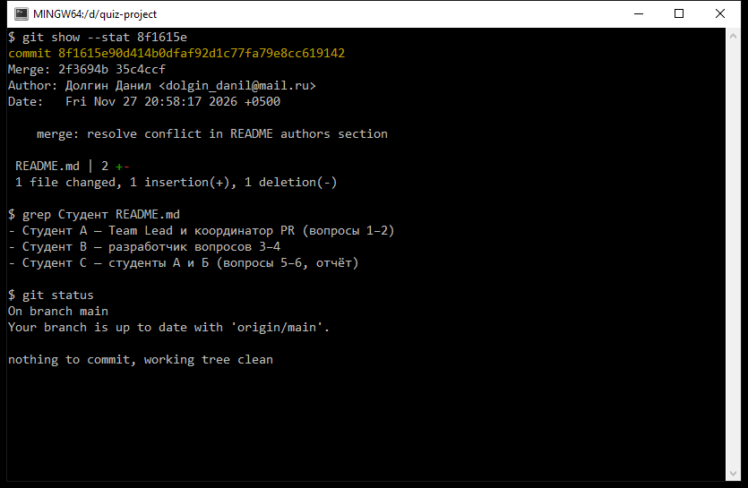
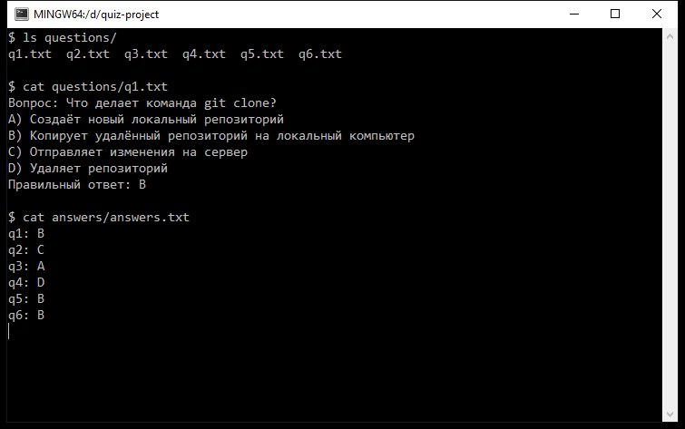

# Отчёт по практической работе «Создание теста командой студентов в Git»

## 1. Тема и цель
**Тема:** создание теста командой студентов в системе контроля версий Git.

**Цель:** освоить командную работу с Git и GitHub: общий репозиторий, работа в отдельных ветках, Pull Request, ревью и слияние, ручное разрешение конфликта слияния.

## 2. Состав команды
Команда из двух человек, поэтому роль студента C (вопросы 5–6, отчёт) разделена между участниками.

| Роль | ФИО | GitHub |
|------|-----|--------|
| Студент A — Team Lead, координатор PR | Сухарева Алина Сергеевна | @asasas1221112434q-dot |
| Студент B — разработчик, QA, отчёт | Долгин Данил Алексеевич | @Spokjy |

## 3. Ссылка на репозиторий
https://github.com/asasas1221112434q-dot/quiz-project

## 4. Распределение задач
- **A:** создание репозитория и структуры, README, приглашение соавтора, вопросы 1–2, ветка `conflict/a`, ревью и слияние Pull Request.
- **B:** вопросы 3–6, файл ответов `answers/answers.txt`, ветка `conflict/b`, ручное разрешение конфликта, финальная проверка, удаление `.gitkeep`, отчёт.

## 5. Хронология работы
1. Создан репозиторий `quiz-project` со структурой `questions/`, `answers/` и README — 27.11.2026.
2. Работа в ветках `feature/q3-q4`, `feature/q5-q6`, `feature/q1-q2` — 27.11.2026.
3. Pull Request #1–#3 созданы и слиты в `main` — 27.11.2026.
4. Ветки `conflict/a` и `conflict/b`: PR #4 (`conflict/a`) слит первым, при слиянии `conflict/b` возник конфликт в README, разрешён вручную — 27.11.2026.
5. Финальная проверка, удаление временных файлов `.gitkeep`, отчёт — 27.11.2026.

## 6. Использованные команды Git
| Команда | Назначение |
|---------|-----------|
| `git config --global user.name / user.email` | Настройка автора коммитов |
| `git clone <url>` | Копирование удалённого репозитория на компьютер |
| `git checkout main` | Переход на основную ветку |
| `git pull origin main` | Получение и объединение изменений с GitHub |
| `git checkout -b <ветка>` | Создание новой ветки и переход на неё |
| `git add <файлы>` | Добавление изменений в индекс |
| `git status` | Просмотр состояния рабочей директории |
| `git commit -m "..."` | Фиксация изменений |
| `git push -u origin <ветка>` | Отправка ветки на GitHub |
| `git merge <ветка>` | Слияние ветки с текущей |
| `git branch -d <ветка>` | Удаление локальной ветки |
| `git rm <файлы>` | Удаление файлов из репозитория |
| `git log --oneline --graph --all --decorate` | Просмотр истории и графа ветвлений |
| `git fetch --prune` | Обновление списка удалённых веток |

## 7. Скриншоты
**Рисунок 1 — Граф коммитов (`git log --graph`)**

**Рисунок 2 — Список Pull Requests (4 PR, все слиты)**

**Рисунок 3 — Момент конфликта: маркеры в README.md**

**Рисунок 4 — Успешный merge: конфликт разрешён, README содержит все строки**

**Рисунок 5 — Финальная проверка: 6 вопросов и файл ответов**

## 8. Возникшие трудности и их решение
1. **Отказ в доступе (ошибка 403) при первой отправке ветки.** На компьютере был сохранён вход другого аккаунта GitHub, у которого нет доступа к репозиторию. Решение: в адресе репозитория указан нужный пользователь (`https://Spokjy@github.com/...`), после входа отправка прошла.
2. **Новое окно терминала открывается в домашней папке.** Казалось, что проект пропал. Решение: перейти в папку проекта командой `cd`.
3. **Конфликт слияния в README.md.** Обе ветки изменили одну и ту же строку. Решение: вручную оставлены обе правки, удалены маркеры `<<<<<<<`, `=======`, `>>>>>>>`, затем `git add` и merge-коммит.

## 9. Выводы
В ходе работы команда создала общий репозиторий на GitHub, работала параллельно в отдельных ветках, объединяла изменения через Pull Request и вручную разрешила конфликт слияния. Итог: в репозитории 6 файлов вопросов по шаблону, файл ответов, README с составом команды. История содержит 6 веток (`feature/q1-q2`, `feature/q3-q4`, `feature/q5-q6`, `conflict/a`, `conflict/b`, `main`), 4 слитых Pull Request и merge-коммит с разрешённым конфликтом. Работа в ветках позволяет не мешать друг другу, а Pull Request дают проверить изменения перед попаданием в основную ветку.
